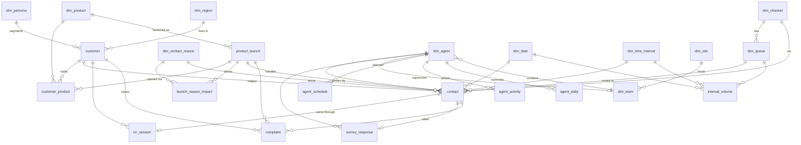

# Happen Bank Contact Center — Demo Dataset

Interactive banking analytics using PostgreSQL, Python, and AI Assisted Development.

> **100% synthetic data.** Generated for dashboard demonstrations. This is **not** real Happen Bank data, and every agent, supervisor and customer is fictional. Product names are generic.

| | |
|---|---|
| **Database** | PostgreSQL 18 · `localhost:5432` · database `happen_demo` · schema `cc` |
| **Period** | 2024-01-01 → 2026-10-31 (34 months, 1,035 days) |
| **Time zone** | All timestamps are `timestamptz`, displayed in America/Chicago |
| **Hours** | Phone & chat: Mon–Fri 7:00–21:00, Sat 8:00–17:00, closed Sun and 6 major holidays. Email/secure message arrive 24/7 and are worked in business hours. |
| **Rebuild** | `powershell -File sql\run_all.ps1` (about 75 minutes; drops and recreates `happen_demo`) |

## Row counts

| Table | Rows | | Table | Rows |
|---|---:|---|---|---:|
| `contact` | 5,907,856 | | `agent_activity` | 1,252,996 |
| `ivr_session` | 4,557,346 | | `interval_volume` | 840,941 |
| `customer_product` | 4,502,633 | | `agent_schedule` | 803,390 |
| `survey_response` | 468,924 | | `complaint` | 271,419 |
| `customer` | 400,000 | | `agent_daily` | 123,533 |

Every fact and customer table has more than 100K rows. Lookup tables keep their natural sizes. The database is about 3.9 GB. `sql\99_validate.sql` runs 24 consistency checks, and all pass.

### Headline KPIs (as generated)
| Year | Phone SL | Chat SL | Email SL | Phone ASA | Phone abandon | Phone AHT | Adherence | CSAT | NPS |
|---|---:|---:|---:|---:|---:|---:|---:|---:|---:|
| 2024 | 80.2% | 85.5% | 94.9% | 17 s | 3.7% | 453 s | 91.8% | 83.1% | +35 |
| 2025 | 67.5% | 73.0% | 94.3% | 27 s | 6.0% | 469 s | 92.6% | 81.7% | +33 |
| 2026 | 79.0% | 82.7% | 94.4% | 18 s | 4.0% | 463 s | 91.8% | 82.5% | +35 |

Monthly, phone service level runs about 80–84% in normal months. It falls to 34% in August 2025 (the staffing crunch) and 55% in February 2026 (the mobile app re-platform).

## Entity-relationship diagram



## Tables

### Lookup tables
| Table | Rows | What it holds |
|---|---|---|
| `dim_date` | 1,035 | Calendar with day/week/month/quarter/year, `is_holiday`, `holiday_name`, `is_center_closed`, `is_month_start_window`, `is_payday` |
| `dim_time_interval` | 96 | 15-minute slots: `interval_start`, `hour_of_day`, `daypart` |
| `dim_channel` | 5 | Phone, Chat, Email, Callback, Secure Message, each with `sl_target_pct` / `sl_threshold_sec` |
| `dim_queue` | 14 | Routing queues per channel; Phone – Fraud & Disputes uses an 80/20 target |
| `dim_site` | 3 | Central Campus (Kansas City), Lakeside Center (Madison), Partner Site (outsourced, San Antonio) |
| `dim_team` | 12 | Teams per site/channel, with `supervisor_id` |
| `dim_agent` | 374 | 362 agents + 12 supervisors: fictional `first_name`, `last_name`, `display_name`, hire/term dates, hiring class, shift pattern, chat concurrency |
| `dim_region` | 40 | State, metro, urban/suburban/rural |
| `dim_persona` | 8 | Digital Native Starter, Busy Young Family, Small Business Owner, Established Professional, Pre-Retiree Planner, Retiree Traditionalist, Credit Builder, Affluent Investor |
| `dim_product` | 28 | Deposit, card, lending, mortgage, digital and business products |
| `product_launch` | 16 | Launches, migrations and pricing changes with target personas |
| `launch_reason_impact` | 46 | Which contact reasons each launch drives, and the modelled peak lift |
| `dim_contact_reason` | 38 | Reasons in 7 groups: Account Servicing, Card, Fraud/Dispute, Digital Access, Lending, Product Inquiry, Complaint |

### Fact and customer tables
| Table | Grain | Key columns |
|---|---|---|
| `customer` | customer | persona, region, age/age band, gender, income band (~2% null by design), segment, customer_since, digital enrolment, language, household size |
| `customer_product` | customer × product | open/close dates, status, `opened_via_launch_id` |
| `contact` | one contact | **channel, queue, agent, reason, launch**; `offered_ts`, `answered_ts`, `abandoned_ts`, `customer_end_ts`, `wrap_end_ts`; `queue_wait_sec`, `talk_sec`, `hold_sec`, `hold_count`, `wrap_sec`, `handle_sec`; `answered`, `abandoned`, `short_abandon`, `met_service_level`, transfers, FCR, repeat within 7 days, escalation, sentiment, chat concurrency, email reply count |
| `ivr_session` | IVR call | contained self-service vs. opted out to an agent (`contact_id`) |
| `survey_response` | survey | CSAT (1–5), NPS (0–10), CES (1–7, 7 = very easy), verbatim theme |
| `complaint` | complaint | source channel, category, severity, regulatory flag, root cause, launch, days to close |
| `interval_volume` | 15 min × queue | forecast vs. offered, answered, answered within SL, abandoned, AHT, ASA, scheduled vs. required FTE, SL %, abandon % |
| `agent_schedule` | scheduled block | **The plan**: Open Shift, Break, Lunch, Training, Coaching, Meeting, PTO |
| `agent_activity` | state change | **What happened**: Available, Break, Lunch, Training, Coaching, Meeting, Unavailable (no row = logged out) |
| `agent_daily` | agent × workday | adherence, conformance, late login, early logout, extended breaks, unplanned aux, occupancy, shrinkage by type, contacts by channel, averages, FCR, quality score |

## Contact timeline

```
offered_ts ──queue_wait──▶ answered_ts ──talk + hold──▶ customer_end_ts ──wrap──▶ wrap_end_ts
           (or ──▶ abandoned_ts)
handle_sec = talk_sec + hold_sec + wrap_sec
```
- **Phone / chat:** offered = entered queue, answered = agent connected, customer_end = customer disconnected.
- **Email / secure message:** offered = message received, answered = agent opened it, customer_end = reply sent.
- **Callback:** offered = callback requested, answered = agent called the customer back.
- Agents only handle contacts inside their logged-in **Available** time. Phone/email agents never overlap contacts. Chat agents run 2–3 chats at once (`concurrent_chats`).

## KPI definitions

| KPI | Formula | Notes |
|---|---|---|
| **Service level %** | answered within threshold ÷ (answered + abandoned − short abandons) | Thresholds per queue (`dim_queue.sl_threshold_sec`). Short abandon = gave up in under 5 s |
| **ASA** (average speed of answer) | avg `queue_wait_sec` of answered contacts | |
| **Abandon rate** | abandoned ÷ offered | Phone and chat only |
| **AHT** (average handle time) | avg (`talk_sec` + `hold_sec` + `wrap_sec`) | "How long the contact took" |
| **Average wrap-up** | avg `wrap_sec` | Work after the customer disconnects |
| **Schedule adherence** | minutes where actual state = scheduled activity ÷ scheduled minutes | Did they do the right thing **at the right time** |
| **Conformance** | logged-in minutes ÷ scheduled minutes | Did they work the **right amount** of time (can exceed 100%) |
| **Occupancy** | handle time ÷ Available time | Chat divided by allowed concurrent chats |
| **Shrinkage** | (breaks + lunch + training + coaching + meetings + unplanned aux + absence) ÷ scheduled time | Components are separate columns in `agent_daily` |
| **FCR** | resolved on first contact ÷ answered | `repeat_within_7d` is the behavioural check |
| **CSAT %** | surveys with 4 or 5 ÷ surveys | |
| **NPS** | % promoters (9–10) − % detractors (0–6) | |
| **CES** | avg effort score, 1–7, 7 = very easy | |
| **Forecast error** | (offered − forecast) ÷ forecast | Forecast = avg of the same interval on the previous 4 same weekdays |
| **IVR containment** | contained IVR sessions ÷ all IVR sessions | |

> **Dashboard tip:** always aggregate ratios from their numerators and denominators (for example `sum(answered_within_sl) / sum(answered + abandoned − short_abandoned)`). Don't average daily percentages.

## Views for dashboards
| View | Use it for |
|---|---|
| `v_contact_detail` | Contact-level exploration: agent name, team, site, supervisor, persona, demographics, launch, all durations, survey scores |
| `v_service_level_interval` | Intraday SL, ASA, abandon %, forecast vs. actual, scheduled vs. required FTE |
| `v_service_level_daily` | Daily SL %, ASA, longest wait, abandon %, AHT by channel and queue |
| `v_handle_time` | Monthly talk / hold / wrap / AHT (and P90) by channel, agent, team, site, reason |
| `v_agent_adherence` | Daily adherence, conformance, occupancy and shrinkage per agent |
| `v_agent_scorecard` | Monthly agent scorecard: volume, AHT, wrap, FCR, transfers, CSAT, NPS, adherence, occupancy, quality |
| `v_launch_impact` | Each launch from 8 weeks before to 12 weeks after, vs. a same-weekday pre-launch baseline (index 100) |
| `v_persona_kpis` | KPIs by persona, age band, income, gender, segment, state, area type, channel, month |

## Stories built into the data
1. **Seasonality.** Monday peaks, quiet Saturdays, payday and month-start bumps, a tax-document surge every Feb–Apr, holiday fraud and card-decline spikes each Nov–Dec, post-holiday surges.
2. **Summer 2025 staffing crunch.** Higher attrition from March 2025 plus a hiring freeze (mid-April to late July) cut phone headcount from ~117 to ~85. Service level collapses (worst in August 2025), abandons and waits rise, adherence and satisfaction slip, then everything recovers as new hires ramp up in Q4 2025. The Small Business Digital Onboarding launch (16 June 2025) lands in the middle of it.
3. **Product launches.** Each launch lifts its related contact reasons for 4–8 weeks, mostly among its target personas, with longer handle times and lower FCR while agents learn.
   - **Mobile App Re-platform (9 Feb 2026)** is the biggest: digital access contacts surge, chat queues back up, sentiment drops.
   - **Fee Schedule Change (10 Mar 2025)** drives fee complaints, lower CSAT and checking/overdraft closures among Credit Builders, Busy Families and Digital Natives.
   - **High-Yield Savings (13 Jan 2025)** drives inquiries and account openings with *positive* sentiment. It's a good contrast.
4. **Online banking outage (7–8 Apr 2026).** A sharp one-off spike in digital access contacts and waits. Good for demonstrating annotations and outlier handling.
5. **Personas and demographics.** Retiree Traditionalists phone more, talk longer and score higher on CSAT. Digital Natives prefer chat and react to app problems. Small Business Owners favour email and transfer more. Credit Builders raise more disputes, fee contacts and complaints.
6. **Workforce.** New hires (first ~90 days) have longer handle and wrap times, lower FCR and quality, and lower adherence.
   - Typical agents average ~92.6% adherence. About 8% are chronic offenders at ~87%, with late logins, long breaks, off-plan breaks and extra aux time. Individual agents range from ~84% to ~98%.
   - Adherence dips ~2 points during the summer 2025 crunch and is worse on Mondays and after holidays.
   - The outsourced partner site has lower FCR and adherence.
   - Example "story" agents for September 2026: Rebecca Castillo (Email – Team Iris) has 83% adherence but 93% CSAT. Coach on schedule, not quality.
7. **Channel shift.** Chat grows and phone shrinks over the 34 months. IVR containment climbs from ~30% to ~42%.
8. **Chat strain in 2026.** Chat demand grows faster than chat staffing, so chat service level runs below target through much of 2026.

## How the data was generated
Every script is in [`sql/`](sql/), seeded with `setseed()` and built in pure SQL:
1. **Workforce first.** Roster with hiring classes and attrition → fictional agents → planned schedules (shift patterns, breaks, lunches, coaching, meetings, launch training, PTO) → actual activity (late logins, extended breaks, early logouts, unplanned aux, absences).
2. **Demand.** A planned staffing baseline × seasonality × launch and incident effects gives expected demand per 15-minute interval. Demand ÷ actual logged-in capacity = load ("pressure").
3. **Contacts.** These are packed back-to-back inside each agent's Available time, so agents never overlap. Idle gaps shrink as pressure rises. Queue wait and abandons grow with pressure, which ties adherence and staffing directly to service level.
4. **Adherence realism.** `06c` turns some idle time into late returns, early departures and unplanned aux. `06d` adds off-plan break, lunch and coaching timing (5-minute steps). Neither moves any contact.
5. **Downstream.** IVR, surveys, complaints, products and the aggregates are derived from the contacts.

Known simplifications:
- Agents work only their primary channel.
- Contact-level states (talking, wrap-up) aren't duplicated into `agent_activity`; they're in `contact`.
- Forecasts are a simple 4-week same-weekday moving average.
- About 175 agents work at any one time (374 people over the period, including attrition and 12 supervisors). That keeps daily workloads realistic for ~5.9M contacts.
- Customers average about 11 product relationships, because digital services (online banking, app, paperless, mobile deposit) and debit cards count as products.
- A fresh rebuild uses the final calibrated parameters, so its numbers will be close to, but not identical to, the figures above.
